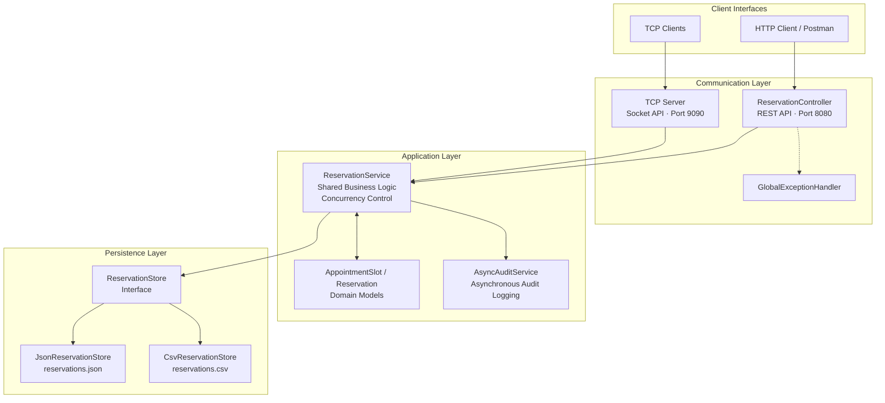

# midterm-concurrent-reservation-service

# Concurrent Reservation Service

**CEN4025 Midterm Project**

**Application:** Appointment Scheduling & Reservation Service

## 1. Project Overview

The Concurrent Reservation Service is a Java Spring Boot application designed to manage appointment reservations across multiple connected clients.
The application allows clients to:
- View available appointment slots.
- Create appointment reservations.
- Retrieve existing reservations.
- Cancel reservations and release appointment slots.
- Access reservation functionality through HTTP and TCP interfaces.

The system demonstrates concurrent network communication, thread-safe reservation processing, asynchronous operations, interchangeable persistence, software architecture, and quality and security practices.
Both communication interfaces use the same underlying `ReservationService` and shared application state.

## 2. Technology Stack

| Technology | Purpose |
|---|---|
| Java | Application development |
| Spring Boot | Application framework and HTTP API |
| Maven | Build and dependency management |
| JUnit 5 | Automated testing |
| Java TCP Sockets | Client/server communication |
| ExecutorService | Concurrent processing and testing |
| JSON | Reservation persistence |
| CSV | Alternative reservation persistence |
| Postman | HTTP API verification |
| Git and GitHub | Version control and issue tracking |

## 3. System Architecture

The application follows a layered architecture that separates communication, business logic, persistence, and supporting services.

### Component Responsibilities

| Package | Responsibility |
|---|---|
| `audit` | Asynchronous reservation audit logging |
| `controller` | HTTP REST API |
| `exception` | Centralized exception handling |
| `model` | Appointment and reservation domain objects |
| `persistence` | JSON and CSV storage implementations |
| `service` | Shared reservation business logic |
| `tcp` | TCP client/server communication |
| `test` | Automated application and service tests |

### Architecture Overview

HTTP clients communicate through `ReservationController`, while TCP clients communicate through the TCP server.

Both interfaces delegate reservation operations to `ReservationService`, which maintains reservation consistency and coordinates access to shared application state.

Persistence is isolated behind the `ReservationStore` interface, allowing JSON and CSV implementations to be selected without modifying reservation-processing logic.

`AsyncAuditService` handles reservation audit events separately from primary request processing.

### Key Architectural Decisions

- **Separation of concerns:** Communication, domain logic, persistence, and auditing have distinct responsibilities.

- **Shared business logic:** HTTP and TCP clients operate against the same reservation service.

- **Concurrency control:** Conflicting booking operations are coordinated to prevent double-booking.

- **Persistence abstraction:** Storage implementations follow a common interface.

- **Asynchronous processing:** Audit activity executes separately from the primary request-processing thread.

## 4. HTTP REST API

### HTTP API Developer Reference
**Base URL:** `http://localhost:8080`

| HTTP Method | Endpoint                 | Description | Expected Status |
|---|--------------------------|---|---|
| GET | `/api/appointments`      | Retrieve available appointments. | `200 OK` |
| POST | `/api/reservations`      | Create a reservation for an available appointment slot. | `201 Created` |
| GET | `/api/reservations/{id}` | Retrieve an existing reservation by ID. | `200 OK` / `404 Not Found` |
| DELETE | `/api/reservations/{id}` | Cancel an existing reservation and release the appointment slot. | `200 OK` or `204 No Content` |
| POST | `/api/reservations`      | Reject a reservation for an already-booked appointment slot. | `409 Conflict` |
| POST | `/api/reservations`      | Reject invalid or incomplete reservation information. | `400 Bad Request` |

### API Documentation Notes
- **Retrieval:** Clients can view available appointment slots and retrieve reservation information.
- **Modification:** Clients can create and cancel appointment reservations.
- **Validation:** Invalid reservation requests are rejected with appropriate HTTP error responses.
- **Concurrency:** The shared reservation service prevents multiple clients from successfully reserving the same appointment slot.
- **Shared State:** HTTP and TCP clients operate against the same reservation data.
- **Persistence:** Reservation data can be stored using JSON or CSV based on application configuration.
- 
### Base URL

`http://localhost:8080`

The HTTP interface provides operations for retrieving appointment availability and managing reservations.

### 4.1 Retrieve Available Appointments

**Method:** `GET`

**Endpoint:** `/api/appointments`

Retrieves available appointment slots.

Example request:
```http
GET http://localhost:8080/api/appointments
```

### 4.2 Create a Reservation

**Method:** `POST`

**Endpoint:** `/api/reservations`

Creates a reservation for an available appointment slot.

Example request:

```http
POST http://localhost:8080/api/reservations
Content-Type: application/json
```

Example request body:

```json
{
  "slotId": "SLOT-001",
  "customerName": "Test Customer"
}
```

Example successful response:

**HTTP 201 Created**

```json
{
  "id": "generated-reservation-id",
  "appointmentSlotId": "SLOT-001",
  "customerName": "Test Customer",
  "createdAt": "2026-10-11T16:32:41"
}
```

The reservation identifier and creation timestamp are generated by the application.

### 4.3 Retrieve a Reservation

**Method:** `GET`

**Endpoint:** `/api/reservations/{reservationId}`

Retrieves information for an existing reservation.

Example request:

```http
GET http://localhost:8080/api/reservations/{reservationId}
```

Replace `{reservationId}` with an actual reservation identifier returned by the application.

### 4.4 Cancel a Reservation

**Method:** `DELETE`

**Endpoint:** `/api/reservations/{reservationId}`

Cancels an existing reservation and releases the associated appointment slot.

Example request:

```http
DELETE http://localhost:8080/api/reservations/{reservationId}
```

After successful cancellation, the appointment slot becomes available for another customer.

### 4.5 HTTP Status Codes

The API uses HTTP status codes to communicate the outcome of requests.

| Status | Meaning |
|---|---|
| `200 OK` | Successful retrieval or operation |
| `201 Created` | Reservation successfully created |
| `400 Bad Request` | Invalid or malformed request |
| `404 Not Found` | Requested resource does not exist |
| `409 Conflict` | Requested appointment slot is unavailable |

The exact response status for cancellation and other unsuccessful operations is determined by the implemented controller and exception handler.

### 4.6 Error Handling

The API handles unsuccessful requests, including:

- Missing or invalid reservation information.

- Invalid appointment slot identifiers.

- Attempts to reserve unavailable slots.

- Requests for nonexistent reservations.

- Conflicting reservation operations.

Centralized exception handling provides controlled error responses without unnecessarily exposing internal application details.

## 5. TCP Client/Server Communication

The application provides a TCP interface on port `9090`.

### Connection Details

- Host: `localhost`

- Port: `9090`

- Protocol: TCP

- Communication: Text-based commands and responses

### Supported Commands

| Command | Description |
|---|---|
| `LIST` | Retrieve available appointment slots |
| `BOOK` | Create a reservation |
| `GET` | Retrieve reservation information |
| `CANCEL` | Cancel an existing reservation |
| `ALL` | Retrieve reservations |
| `HELP` | Display supported commands |
| `QUIT` | Close the client connection |

### Command Examples

```text
LIST
HELP
BOOK SLOT-001 CustomerA
```

The TCP server interprets client commands, executes reservation operations, and returns responses.

Unsupported commands are handled without unexpectedly terminating the server.

### Concurrent Client Support

Multiple TCP clients can connect to the server and interact with the same reservation state.

The application supports concurrent requests while protecting shared reservation data from conflicting modifications.

## 6. Concurrency and Shared State

The reservation system must prevent multiple customers from successfully reserving the same appointment slot.

Concurrency control is implemented in the shared reservation-processing logic to protect reservation integrity.

### Conflicting Booking Scenario

1. Client A attempts to reserve `SLOT-001`.

2. Client B attempts to reserve the same slot.

3. The application coordinates access to shared reservation state.

4. Only one reservation is permitted to succeed.

5. The unsuccessful request is rejected without corrupting reservation data.

This behavior applies to reservation operations performed through the shared service.

### Automated Concurrency Verification

The concurrency test uses:

- `ExecutorService`

- `CountDownLatch`

- Two competing booking tasks

- Assertions verifying the final reservation state

The test confirms that only one booking succeeds when two threads attempt to reserve the same appointment slot.

## 7. Asynchronous Processing
The application includes `AsyncAuditService` for asynchronous reservation audit processing.

Reservation activity can generate audit events without requiring audit processing to execute directly on the primary request thread.

Examples of audit activity include reservation creation and cancellation events.

Asynchronous processing separates supporting operations from the primary reservation workflow.

## 8. Persistence and Configuration

The application supports two interchangeable reservation storage formats.

### Supported Persistence Implementations

| Implementation | Storage Format | File |
|---|---|---|
| `JsonReservationStore` | JSON | `data/reservations.json` |
| `CsvReservationStore` | CSV | `data/reservations.csv` |

### Persistence Abstraction

Both implementations use the common `ReservationStore` interface.

The interface defines operations for loading and saving reservation information.

`ReservationService` uses this abstraction instead of directly depending on JSON or CSV file-handling logic.

### Switching Persistence Implementations

The active persistence mechanism is selected through application configuration.

To change storage formats:

1. Open `src/main/resources/application.properties`.

2. Locate the persistence configuration setting.

3. Select the supported JSON or CSV implementation.

4. Restart the application.

5. Verify reservation creation and retrieval using the selected format.

The persistence selection does not require changes to the core reservation-processing logic.

**Configuration note:** Document the exact property name and accepted values from `application.properties` before final submission.

### Persistence Verification

Both JSON and CSV implementations were manually exercised using HTTP reservation operations.

Reservation information was written to the selected storage file and retrieved through the application.

The persistence design supports architectural change by separating data storage from reservation business logic.

## 9. Software Quality and Security

The application incorporates quality and security considerations relevant to a networked reservation service.

### Input Validation

Reservation operations validate request information and reject unsupported or invalid inputs.

Validation helps prevent malformed requests from producing invalid reservation state.

### Error Handling

The application includes `GlobalExceptionHandler` for centralized HTTP exception handling.

Controlled error responses help prevent unnecessary disclosure of internal implementation details.

### Shared Resource Integrity

Concurrency control prevents conflicting reservations from violating appointment availability rules.

### TCP Request Handling

Unsupported TCP commands produce controlled responses rather than unexpectedly terminating the server.

### Security Principles

The implementation considers relevant software security practices, including:

- Input validation.

- Controlled exception handling.

- Protection of shared application state.

- Reduced exposure of internal implementation details.

- Dependency security review.

### Issue Tracking

Significant defects and security-related concerns identified during development are documented through GitHub Issues and associated corrective changes where applicable.

## 10. Automated Testing

Automated tests are implemented using JUnit 5 and Maven.

### Test Coverage

The test suite exercises reservation behavior, including:

- Retrieving available appointment slots.

- Creating reservations.

- Rejecting unsuccessful reservation operations.

- Validating reservation inputs.

- Verifying reservation state changes.

- Preventing duplicate bookings during concurrent requests.

### Concurrency Test

The concurrency test uses two synchronized threads attempting to reserve the same appointment slot.

Assertions verify:

- Exactly one booking succeeds.

- Only one reservation exists for the contested slot.

- Remaining appointment availability is consistent.

### Test Execution

Run the automated tests from the project root:

```powershell
.\mvnw.cmd test
```

The verified test execution completed with:

- 10 tests executed.

- 0 failures.

- 0 errors.

- 0 skipped tests.

- `BUILD SUCCESS`.

### Manual Verification

Manual verification includes:

- TCP connection and command testing.

- Multiple concurrent TCP clients.

- Conflicting reservation attempts.

- HTTP requests through Postman.

- Reservation cancellation and rebooking.

- Invalid request handling.

- JSON and CSV persistence.

- Asynchronous audit activity.

## 11. Build and Run Instructions

### Prerequisites

- A compatible Java Development Kit (JDK).

- Windows PowerShell or another supported terminal.

- IntelliJ IDEA or another Java development environment.

- Postman for optional HTTP testing.

### Clone the Repository

```powershell
git clone https://github.com/fundvmentvl/midterm-concurrent-reservation-service.git
```

Navigate to the project:

```powershell
cd midterm-concurrent-reservation-service
```

### Run Tests

```powershell
.\mvnw.cmd test
```

### Start the Application

```powershell
.\mvnw.cmd spring-boot:run
```

### Application Interfaces

| Interface | Address |
|---|---|
| HTTP REST API | `http://localhost:8080` |
| TCP Server | `localhost:9090` |

The application can be tested through Postman and independent TCP client connections.

## 12. Known Limitations and Future Improvements

The application is intended to demonstrate core software engineering concepts in a local development environment.

Current architectural limitations include file-based persistence and a single application instance.

Potential future improvements include:

- Authentication and role-based authorization.

- Database-backed transactional persistence.

- Distributed concurrency control.

- Expanded integration and performance testing.

- Structured monitoring and operational metrics.

- Production deployment configuration.

These improvements are outside the primary scope of the midterm implementation.

## 13. Project Deliverables

The project demonstrates the following CEN4025 midterm requirements:

1. System architecture and component separation.

2. TCP-based client/server communication.

3. Concurrent client handling and shared state protection.

4. HTTP API operations.

5. Interchangeable JSON and CSV persistence.

6. Software quality and security considerations.

7. Automated testing and final system verification.

Supporting screenshots, test results, and architectural documentation are provided in the separate **CEN4025 Midterm Project Evidence** document.
 